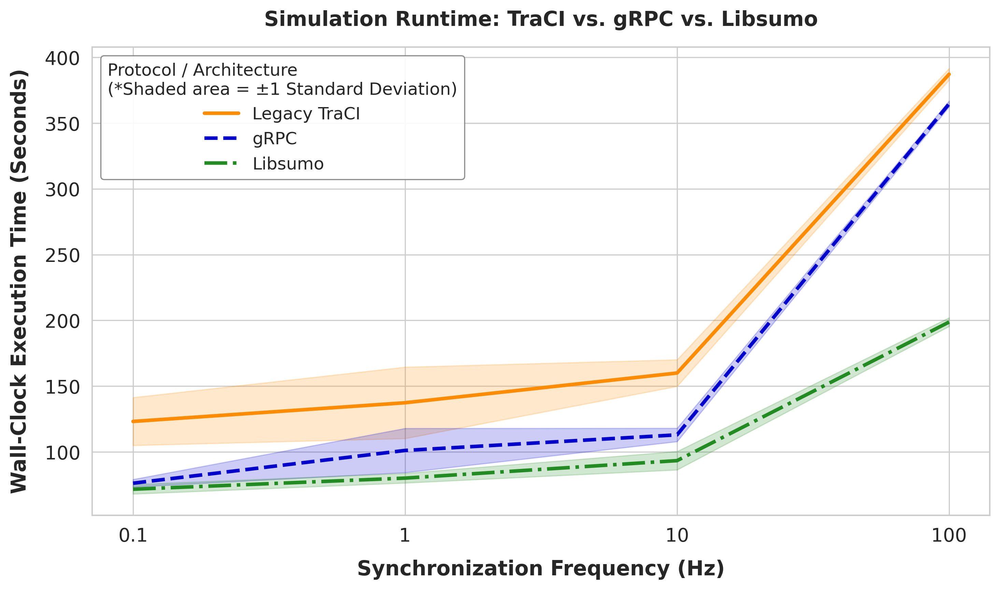

# Synchronization Frequency vs. Wall-Clock Runtime Plot

This script generates a comparison plot evaluating the synchronization frequency between OMNeT++ and SUMO against the wall-clock execution runtime across three architectures:
- **Legacy TraCI** (Solid line, Dark Orange)
- **gRPC** (Dashed line, Medium Blue)
- **Libsumo** (Dash-dot line, Forest Green)

The plot displays the **average (mean)** execution time across 5 pseudo-random seed values along with a **shaded band representing ±1 standard deviation ($\pm 1\,\text{SD}$)**.

---

## Output

The script outputs a single high-resolution image:
- `frequency_vs_runtime.png` (300 DPI, academic whitegrid layout matching thesis figures)



---

## Step-by-Step Instructions (Ubuntu Terminal / WSL)

### 1. Open Ubuntu Terminal and Navigate to the Directory (Local example given here)
```bash
cd "/mnt/f/4. Academic(MSc)/Thesis/FREQUENCY TEST PLOT"
```

### 2. Install Required Python Packages (One-Time Setup)
If you haven't already installed the required visualization packages, install them using `pip`:
```bash
pip3 install pandas matplotlib seaborn
```
*(Or alternatively via Ubuntu apt)*:
```bash
sudo apt update
sudo apt install -y python3-pandas python3-matplotlib python3-seaborn
```

### 3. Run the Script
```bash
python3 plot_frequency.py
```

### 4. Verify the Generated Plot
Once the script completes, `frequency_vs_runtime.png` will be created in this directory:
```bash
ls -l frequency_vs_runtime.png
```

---

## Input Data Files

The script expects the following CSV files in the same directory:
- `traci_frequency.csv`
- `grpc_frequency.csv`
- `libsumo_frequency.csv`

Each CSV file contains:
- `SEED`: Random seed index (0 to 4)
- `FREQUENCY`: Synchronization frequency (0.1, 1, 10, 100 Hz)
- `TIME`: Wall-clock execution time in seconds
